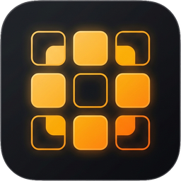
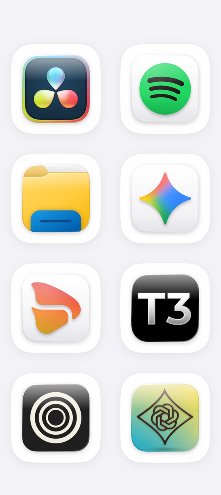
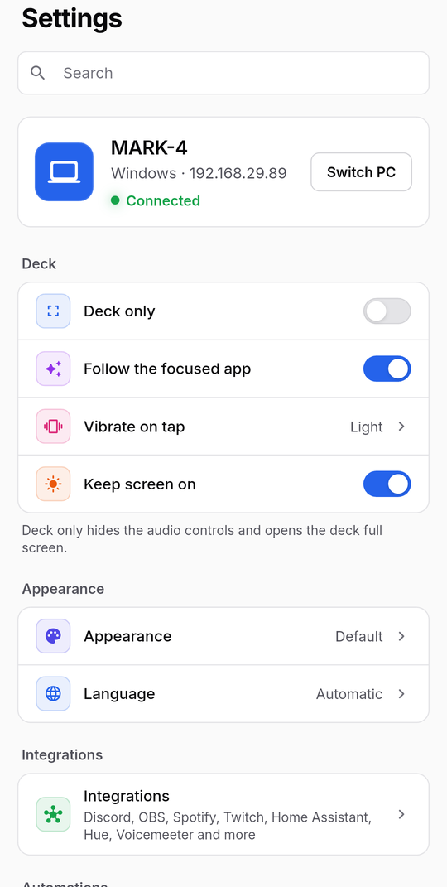
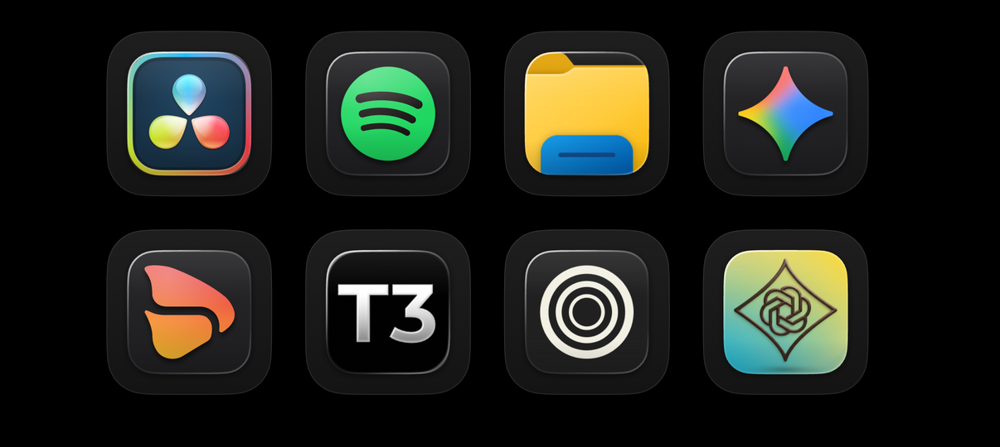
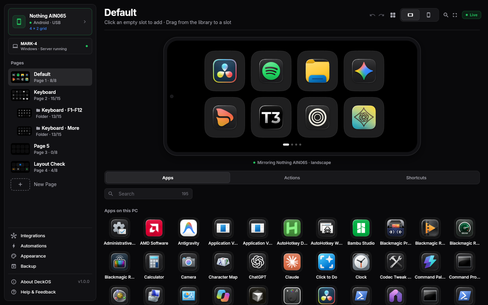
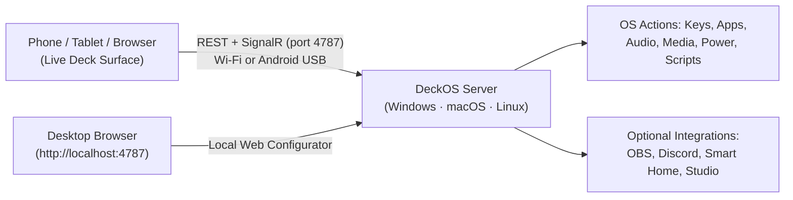

<div align="center">



# DeckOS

**Turn your phone, tablet, or browser into a fast, customizable control deck for your computer.**

[](LICENSE)
[](https://github.com/itskavin/DeckOS/actions/workflows/ci.yml)
[](https://github.com/itskavin/DeckOS/releases/latest)

[**Releases**](https://github.com/itskavin/DeckOS/releases) ·
[**Website**](https://itskavin.github.io/DeckOS/) ·
[**Documentation**](https://itskavin.github.io/DeckOS/docs/)

</div>

---

DeckOS turns an Android phone, an iPhone/iPad browser, or another screen into a live Stream Deck–style control surface for your PC. Tap buttons to trigger shortcuts, launch apps, mix per-app audio, control media, run timers and automations, and drive streaming, studio, or smart-home tools—directly over your local Wi-Fi or a USB cable, with no DeckOS cloud account required.

<p align="center">
  
  &nbsp;
  
</p>
<p align="center">
  
</p>
<p align="center">
  
</p>
<p align="center"><sub>Real captures from a Nothing Phone (Android 16) and the Windows PC it controls. The configurator mirrors the phone that is actually connected.</sub></p>

## How DeckOS Works

DeckOS has **two required halves** that talk directly to each other over your local network (or USB on Android):

1. **Desktop server (`DeckOS`)** — Runs on your computer (Windows tray app, or console/background service on macOS and Linux). It executes actions, monitors system/media/integration state, and serves the browser-based configurator on port `4787`.
2. **Deck client** — Either the **Android app (`DeckOS.apk`)** or the **web deck in any modern browser** (iPhone, iPad, tablet, or second screen).



### Security Model (Local-First)

- Every API and SignalR connection is authenticated with a per-PC **API key** exchanged during QR pairing (or manual entry).
- **Privileged actions** that run code or send local network requests (launching apps, keyboard keys/hotkeys, activating windows, scripts, HTTP webhooks, OSC/TCP/UDP messages, command/URL info tiles) can only be **created or modified from the local desktop configurator** (`http://localhost:4787`). Remote clients—including phones connected over USB—can trigger already-saved buttons by ID and safely edit non-privileged actions.

---

## Quick Setup (Phone + PC)

### 1. Start DeckOS on Your Computer

- **Windows (10 1809+ / 11, x64):** Run `DeckOS-Setup.exe` from [Releases](https://github.com/itskavin/DeckOS/releases) (installs as a system tray app with auto-updates), or extract `DeckOS-win-x64.zip` and run `DeckOS.exe`. No separate .NET install is required for release builds. No DeckOS release has been published yet; until one is, build from source (see [Development](#development--building-from-source)).
- **macOS (Apple Silicon / Intel) & Linux (x64 / arm64) — Preview:** Extract the release archive and run `./DeckOS --open` in a terminal, or install as a user service with `./install-macos.sh` (launchd) or `./install-linux.sh` (systemd user service). Both scripts support `--uninstall`.

### 2. Connect Your Phone or Tablet

- **Android (7.0+):** Install `DeckOS.apk` from Releases (or build it from source until the first release is published).
  - **Wi-Fi:** Make sure phone and PC are on the same local network, open the pairing QR on the PC (Windows tray icon → **Pair device (QR)…**, or printed in the terminal on macOS/Linux), and scan it in the app—or use auto-discovery / manual IP + pairing key.
  - **USB cable (no Wi-Fi needed):** Enable USB Debugging on Android, plug in a USB cable, and ensure `adb` (`platform-tools`) is available on the PC. DeckOS automatically maintains an `adb reverse` bridge on port `4787`, and the app seamlessly switches between USB and Wi-Fi if one drops.
- **iPhone, iPad, or any other device (Browser Deck):** No native iOS app is required. Scan the browser pairing QR from the PC (or open `http://<PC-LAN-IP>:4787/?pair=<API-KEY>`). The page stores the key locally, strips it from the address bar, and can be added to your Home Screen.

### 3. Edit Your Deck in the Web Configurator

Open `http://localhost:4787/` in a browser on your computer to build and organize pages:

- **Live phone mirror & layout controls:** Drag and drop apps, shortcuts, and actions onto the grid, span multi-cell tiles, switch pages/folders, and customize grid rows/columns, spacing, icon scale, and label visibility.
- **Real connected-device awareness:** The configurator tracks active authenticated deck clients separately from the host PC, showing which phone or browser deck is connected (and via USB or Wi-Fi) or clearly showing when no phone is connected.
- **Instant sync & backups:** Changes push live over SignalR. Export/import `.deckos` backups, share profiles via link/QR, or import Elgato `.streamDeckProfile` files.

---

## Platform Capabilities (Windows, macOS, Linux)

DeckOS reports exact host capabilities via `GET /api/platform` so the UI only offers what the connected computer supports.

| Capability | Windows | macOS (Preview) | Linux (Preview) |
|---|---|---|---|
| System tray, QR dialog & auto-update | Built-in | Console / `launchd` (`--open`) | Console / `systemd --user` (`--open`) |
| Keyboard keys, hold-keys & hotkeys | Built-in (`SendInput`) | Built-in (needs Accessibility permission) | X11 (`xdotool`) · Wayland (`ydotool` / `wtype`) |
| App launcher & installed apps library | Built-in (incl. Store apps) | Built-in (`.app` bundles) | Built-in (`.desktop`, `xdg-open` / `gtk-launch`) |
| Window activation & auto-profile switching | Built-in | Built-in (Accessibility) | X11 (`xdotool`, `wmctrl`) · Unavailable on Wayland |
| Master & microphone volume | Built-in (WASAPI/NAudio) | Built-in (`osascript`) | `wpctl` (WirePlumber) or `pactl` (PulseAudio) |
| Per-app audio mixer & default device switch | Built-in | Unavailable | Per-app mute/volume via `pactl`; no default-device switch |
| Media controls & Now Playing | Built-in (WinRT SMTC) | Built-in | `playerctl` |
| Soundboard (MyInstants) | Built-in + device routing (VB-Cable/monitor) | Default output (`afplay`) | Default output (`mpv` / `ffplay` / `paplay` / `pw-play`) |
| Power actions (lock, sleep, display off) | Built-in | Built-in (`pmset` / Accessibility) | `loginctl`, `systemctl`, `xset` / `busctl` |
| System monitor (CPU, RAM, disk, network) | Built-in (+ GPU) | Built-in | Built-in |
| Scripts | PowerShell, Python, `.bat`/`.cmd` | Shell (`sh`), optional `python3` / `pwsh` | Shell (`sh`), optional `python3` / `pwsh` |
| Windows-only extras | Macro recorder, monitor brightness (DDC/CI), Voicemeeter | Not available | Not available |
| Discovery & USB bridge | UDP (`7573`), mDNS (`_deckos._tcp`), USB (`adb`) | UDP, mDNS, USB (`adb`) | UDP, mDNS, USB (`adb`) |

Data locations:
- **Windows:** `%LocalAppData%\DeckOS` (API key, encrypted integration credentials, cache) and `%AppData%\DeckOS` (profiles, layout, counters, triggers).
- **macOS:** `~/Library/Application Support/DeckOS`
- **Linux:** `$XDG_CONFIG_HOME/deckos` (or `~/.config/deckos`)

---

## Core Features & Automations

- **Deck & navigation:** Unlimited pages and folders, multi-cell buttons, two-state toggle buttons, tap / long-press / double-tap gestures, sliders (volume, media seek, monitor brightness, OBS audio, Discord user volume, smart lights), animated GIF icons, and haptic tap feedback.
- **Distraction-free deck:** The bar, page dots, and tab bar around the deck hide after 5 seconds without a touch; the buttons never move and stay tappable. Tap an empty spot or the top edge to bring the controls back. Editing (layout, grid, settings) lives in the top bar.
- **Screen stays awake:** While DeckOS is open in the foreground (deck, audio, or settings), the phone screen stays on; it is released as soon as the app goes to the background. Turn it off under **Settings → Keep screen on**.
- **Live info & monitors:** CPU, GPU (Windows), RAM, disk, and network gauges; clock, weather, now playing, command output, URL JSON/text values, countdown timers, stopwatches, pomodoros, and persistent counters.
- **Automations (`Triggers`):** Automatically press any saved deck button on:
  - **Schedule** (`HH:mm` + days of week)
  - **App opened / App closed** (by process name)
  - **PC resumed from sleep**
  - **DeckOS startup**
  - **Tally On Air / Off Air** (OBS, vMix, mAirList, RadioDJ, Voicemeeter, or manual)
  - Optional extra conditions (`obs_streaming`, `obs_recording`, `discord_mute`, `discord_deaf`, `toggle_on`, `app_running`, `app_focused`, `time_between`, `weekday`, `tally_program`, `tally_preview`).

---

## Integrations

DeckOS includes built-in backend providers and settings screens for the integrations below. **External integrations require the corresponding software, hardware, or developer/OAuth account on your side**—DeckOS does not bundle third-party credentials or run a cloud proxy.

| Category | Integration | How it connects | Notes & requirements |
|---|---|---|---|
| **Streaming & Voice** | [OBS Studio](https://itskavin.github.io/DeckOS/docs/integrations/obs/) | Local `obs-websocket` v5 (`ws://host:4455`) | Built into OBS 28+; supports QR scan & live scenes/recording/streaming/filters/sources/audio |
| | [Discord](https://itskavin.github.io/DeckOS/docs/integrations/discord/) | Local Discord IPC pipe/socket | Requires your own Discord Developer app (Client ID + Secret + `http://localhost:4787/discord` redirect) |
| | [Twitch](https://itskavin.github.io/DeckOS/docs/integrations/twitch/) | Twitch Helix API (OAuth Device Code) | Requires your own public Twitch app Client ID |
| | [YouTube](https://itskavin.github.io/DeckOS/docs/integrations/youtube/) | YouTube Data API v3 (OAuth PKCE) | Requires your own Google Desktop OAuth Client ID + Secret |
| | [Streamer.bot](https://itskavin.github.io/DeckOS/docs/integrations/streamerbot/) | Local WebSocket Server (`ws://127.0.0.1:8080/`) | Triggers actions with arguments; supports password auth |
| | [VTube Studio](https://itskavin.github.io/DeckOS/docs/integrations/vtubestudio/) | Local Plugin WebSocket API (`ws://localhost:8001`) | Plugin approval prompt inside VTube Studio |
| **Audio & Media** | [Spotify](https://itskavin.github.io/DeckOS/docs/integrations/spotify/) | Spotify Web API (OAuth PKCE) | Requires your own Spotify app Client ID; playback control requires Spotify Premium |
| | [Soundboard](https://itskavin.github.io/DeckOS/docs/integrations/soundboard/) | MyInstants search + local MP3 cache | Windows supports routing to VB-Cable + optional monitor output |
| | [Voicemeeter](https://itskavin.github.io/DeckOS/docs/integrations/voicemeeter/) | Local Voicemeeter Remote API DLL | Windows only; no setup screen required (Standard / Banana / Potato) |
| **Smart Home & Lighting** | [Home Assistant](https://itskavin.github.io/DeckOS/docs/integrations/homeassistant/) | Local/LAN WebSocket API | Requires URL + Long-Lived Access Token |
| | [Tuya / Smart Life](https://itskavin.github.io/DeckOS/docs/integrations/tuya/) | Smart Life / Tuya Smart QR pairing + MQTT push | Works only with Smart Life or Tuya Smart app scan (rebranded vendor apps reject QR login) |
| | [Philips Hue](https://itskavin.github.io/DeckOS/docs/integrations/hue/) | Local Hue Bridge HTTP API | Press physical Bridge button to pair |
| | [Elgato Key Light](https://itskavin.github.io/DeckOS/docs/integrations/elgato/) | Local HTTP API (port `9123`) | Configured per button by light IP |
| | [Govee](https://itskavin.github.io/DeckOS/docs/integrations/govee/) | Local UDP LAN API | Requires LAN Control enabled in Govee Home |
| | [MQTT](https://itskavin.github.io/DeckOS/docs/integrations/mqtt/) | Direct TCP / TLS broker (`mqtt://` / `mqtts://`) | Publish messages with QoS & retain |
| **Studio, Broadcast & Network** | [vMix](https://itskavin.github.io/DeckOS/docs/integrations/vmix/) | Local TCP API (port `8099`) | Live tally, inputs, overlays, recording/streaming |
| | [Bitfocus Companion](https://itskavin.github.io/DeckOS/docs/integrations/companion/) | Satellite TCP API (port `16622`) | Uses phone/browser as a Companion button surface |
| | [mAirList & RadioDJ](https://itskavin.github.io/DeckOS/docs/integrations/radio/) | Local REST interfaces | Radio automation controls + On-Air / live input state |
| | [Tally & ON AIR](https://itskavin.github.io/DeckOS/docs/integrations/tally/) | Aggregates OBS, vMix, mAirList, RadioDJ, Voicemeeter, manual | Full-screen tally view & trigger events |
| | [Network (OSC / TCP / UDP)](https://itskavin.github.io/DeckOS/docs/integrations/network/) & HTTP Webhooks | Direct local/LAN packets & requests | Privileged actions (created on desktop configurator) |

### Honest Feature & Verification Boundaries

- Core local features (profiles, layout sync, timers, triggers, audio mixer, media control, system monitoring, backups, API auth, and protocol/controller contract tests) are validated directly in the repository test suite.
- Third-party hardware and cloud integrations (OBS, Discord, Spotify, Twitch, YouTube, Home Assistant, Tuya, Philips Hue, Elgato Key Light, Govee, MQTT, Streamer.bot, VTube Studio, Voicemeeter, vMix, Companion, mAirList, RadioDJ) have automated unit/protocol tests for parsing, auth/config validation, state transitions, and error handling, but **live end-to-end execution depends on your installed apps, local devices, or external accounts** and should be verified against your own setup.

---

## Development & Building from Source

### Prerequisites

- **.NET 8 SDK** (for the `DeckOS` server and `DeckOS.Tests`)
- **Flutter SDK** (for the phone app and web configurator in `app/`)
- **Android builds only:** **JDK 21** is required to run the Android Gradle/AGP build toolchain, while the Android app's Java/Kotlin bytecode targets **Java 17** (`sourceCompatibility`, `targetCompatibility`, and `jvmTarget = 17`).

### Repository Layout

```text
DeckOS/
  DeckOS/     C# (.NET 8) backend: WinForms tray (Windows) + ASP.NET Core + SignalR
  app/        Flutter app: Android mobile runtime + browser deck + desktop web configurator
  tests/      xUnit backend tests (net8.0 + net8.0-windows10.0.17763.0)
  scripts/    Build/deploy/install helpers (deploy-web.ps1, install-macos.sh, install-linux.sh)
  website/    Landing page & MkDocs documentation (EN/PT)
```

### Run & Build Commands

```powershell
# 1. Backend server (Windows tray + web server on http://localhost:4787)
dotnet run --project DeckOS -f net8.0-windows10.0.17763.0

# Backend server (macOS / Linux console mode, or headless on Windows)
dotnet run --project DeckOS -f net8.0 -- --open
# Useful flags: --headless (no tray on Windows), --print-pairing (print URI/QR and exit)

# 2. Build & deploy the web configurator into DeckOS/wwwroot
.\scripts\deploy-web.ps1

# 3. Build Android APK (ensure JAVA_HOME points to JDK 21)
cd app
flutter build apk --release --target-platform android-arm64
# (Use --debug for local dev builds)

# 4. Run tests
dotnet test tests/DeckOS.Tests/DeckOS.Tests.csproj -f net8.0-windows10.0.17763.0
cd app && flutter test
```

> **Tip:** Set `DECKOS_DATA_DIR` to an isolated temporary directory when testing so local dev runs do not touch your live profiles, API key, or saved integration secrets.

---

## Troubleshooting

- **Phone cannot find the PC over Wi-Fi:** Ensure both devices are on the same subnet (not guest/isolated Wi-Fi), Windows Firewall allows `DeckOS.exe` on TCP `4787` and UDP `7573`, and try manual IP + pairing key if broadcast/mDNS is blocked by your router.
- **Android USB mode does not connect:** Enable **USB Debugging** on the phone, accept the RSA prompt on the phone screen, verify `adb devices` lists the device as `device` (not `unauthorized`), and confirm `adb` is installed on the PC.
- **Custom port & OAuth callbacks:** If you run the server on a port other than `4787` (`--urls` or `ASPNETCORE_URLS`), copy the exact **Redirect URI** shown in the integration settings screen (DeckOS dynamically uses the bound port).
- **Windows SmartScreen:** Unsigned open-source installers can trigger SmartScreen—click **More info → Run anyway** (or build from source).
- **macOS shortcuts/window switching do nothing:** Grant DeckOS **Accessibility** permission under *System Settings → Privacy & Security → Accessibility*.
- **Linux missing features:** Check `GET /api/platform` (or the configurator status) to see which helper package is missing (`xdotool`, `ydotool`/`wtype`, `wmctrl`, `wpctl`/`pactl`, `playerctl`, `mpv`/`ffmpeg`, `adb`).

More guides: [Installation](https://itskavin.github.io/DeckOS/docs/getting-started/installation/) · [Troubleshooting](https://itskavin.github.io/DeckOS/docs/troubleshooting/) · [Architecture](https://itskavin.github.io/DeckOS/docs/developers/architecture/)

---

## Contributing, Credits & License

Issues and pull requests are welcome—see [CONTRIBUTING.md](CONTRIBUTING.md).

- **Development:** Maintained by [itskavin](https://github.com/itskavin) with AI-assisted development by Claude.
- **Upstream provenance:** DeckOS is a derivative work based on [DroidDeck](https://github.com/ggfto/DroidDeck) by [ggfto](https://github.com/ggfto).
- **License:** Distributed under the [Apache License 2.0](LICENSE). All upstream license and attribution notices are preserved.
- **Logo:** The DeckOS logo was supplied by the maintainer and is not part of upstream DroidDeck. Every icon is generated from [`branding/source/deckos-logo-source.png`](branding/source/deckos-logo-source.png); see [branding/README.md](branding/README.md).
